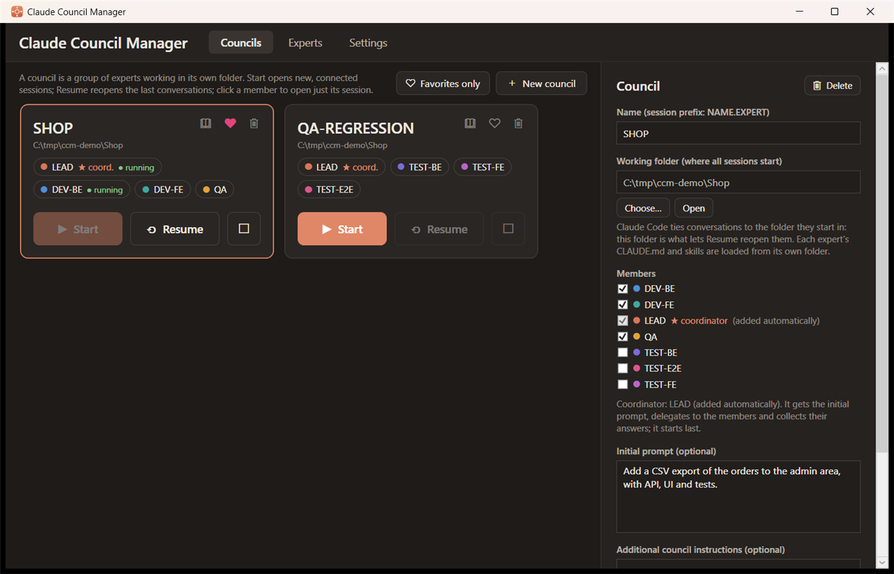
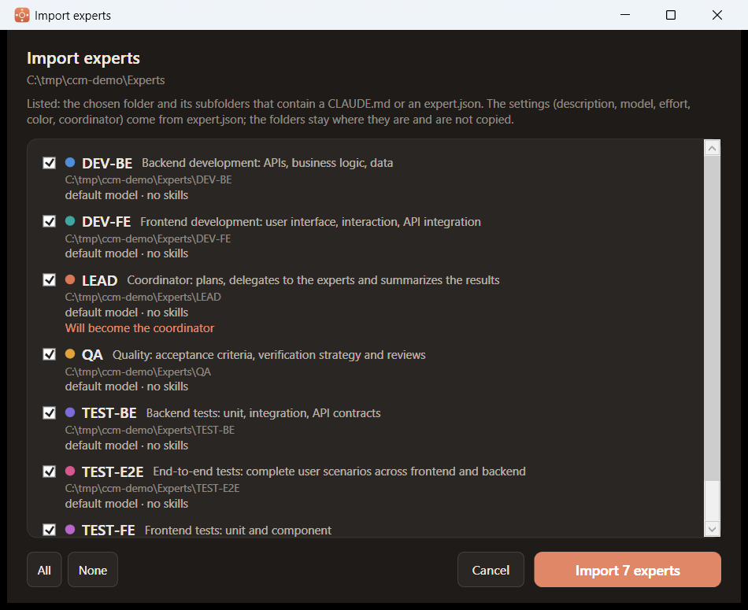
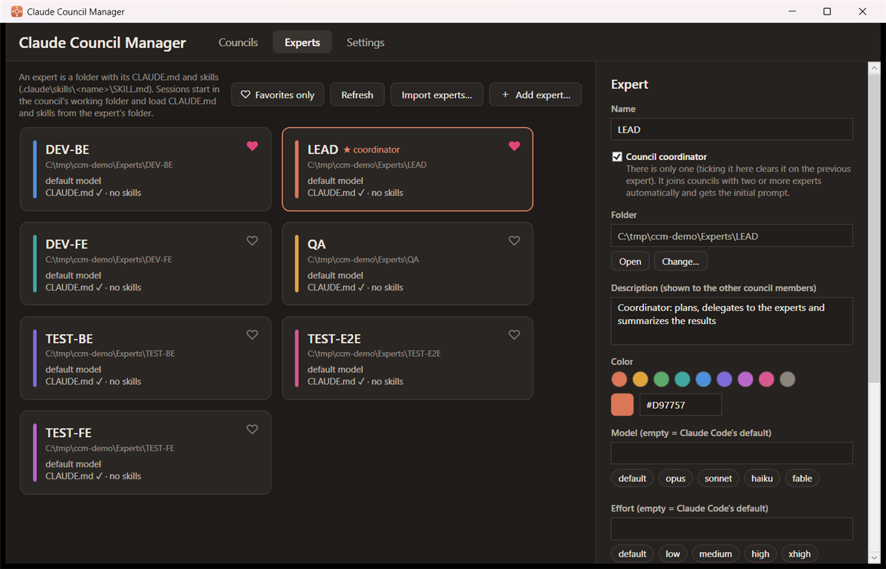
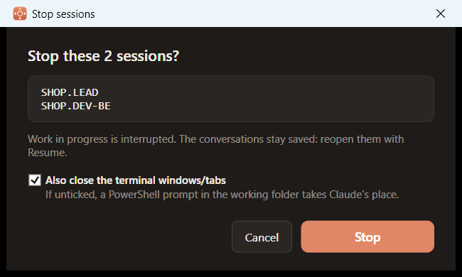
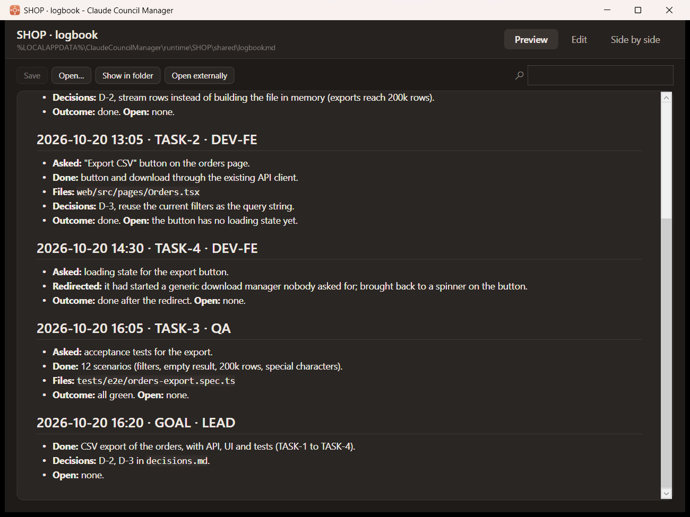
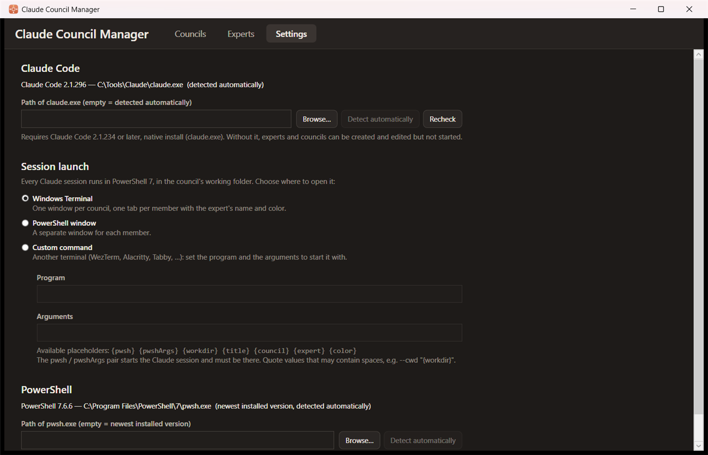

# Claude Council Manager

A Windows desktop app (WPF, .NET 10) to set up and launch **councils**: groups of interactive
[Claude Code](https://code.claude.com) sessions that work together on the same project and message
each other.

- An **expert** is a folder with its own `CLAUDE.md`, its skills and an `expert.json`, for example
  `DEV-BE`, `QA` or `TEST-E2E`. You version it in git and share it with your colleagues.
- A **council** is a working folder (the project) plus a group of experts. With two or more experts
  the **coordinator** joins automatically: it takes your goal, splits it among the experts and
  collects the results.
- **Start** opens a session for each member (a Windows Terminal tab by default). **Resume** reopens
  the last conversations. **■** stops the council's sessions. The book icon opens the **logbook**
  that the coordinator keeps.



## Requirements

| | |
|---|---|
| System | Windows 10 or 11 |
| Claude Code | **2.1.234 or later**, native install (`claude.exe`), signed in. Earlier versions lack cross-session messaging. The app checks this itself: without Claude Code, experts and councils can be created and edited but not started. If you only have the npm version, install the native one with `claude install`. |
| PowerShell | **PowerShell 7.3 or later** (`pwsh`): sessions always run in it, using the newest installed version. Install it with `winget install Microsoft.PowerShell`. Windows PowerShell 5.1 is not enough. |
| Terminal | [Windows Terminal](https://aka.ms/terminal), recommended: each council becomes one window with a tab per member. Alternatively, in **Settings** you can use separate PowerShell windows or another terminal. |
| Build | .NET 10 SDK |

## Installation

Run `ClaudeCouncilManager-Setup-<version>.exe` (see [Building the installer](#building-the-installer)):

- it installs the app for your user only, in `%LOCALAPPDATA%\Programs\Claude Council Manager`,
  without asking for administrator rights;
- it creates a Start menu shortcut; a desktop shortcut is optional;
- if the app is open it closes it before updating. Claude sessions already running keep running.

Uninstalling (from *Installed apps* or the Start menu) asks whether to also delete the app's data
(experts, councils, settings). The default answer is **No**. The expert folders and Claude Code's
conversations are never touched.

## Getting started

This walkthrough uses the experts in the [`Example`](Example) folder: a coordinator (`LEAD`), `QA`,
`DEV-BE`, `DEV-FE`, `TEST-BE`, `TEST-FE` and `TEST-E2E`.

### 1. Start the app

From the Start menu if you installed it. From source:

```powershell
dotnet run
```

Or open `ClaudeCouncilManager.sln` in Visual Studio. On first start the app creates its database in
`%LOCALAPPDATA%\ClaudeCouncilManager`.

### 2. Set up your expert folder

Copy `Example` to a folder of your own, for example `C:\Experts`, ideally a git repository so you
can share it with your team. Don't use `Example` directly: when you edit an expert, the app updates
its `expert.json`, and you would be changing the repo's samples.

### 3. Import the experts

**Experts** tab → **Import experts…** → choose `C:\Experts`.

The preview lists the 7 folders found and shows that `LEAD` will become the coordinator. Click
**Import 7 experts**.



### 4. Customize the experts

Select an expert to edit it in the right-hand panel:

- **Edit CLAUDE.md**: the expert's instructions (role, scope, what it delivers), in the app's
  Markdown editor with a live preview. The samples are generic: adapt them to your stack and
  conventions.
- **Model / Effort**: empty means Claude Code's defaults. For example, give the coordinator
  `opus · high` and the testers `sonnet`.
- **Open skills folder**: add the expert's skills, one subfolder per skill with its `SKILL.md`.
- **Council coordinator**: there is only one. Ticking it on an expert clears it on the previous one.

Changes are saved right away, both in the database and in the expert's `expert.json`.



The heart (♥) on a card adds the expert to your favorites, which always stay at the top of the
list; **Favorites only** filters the list. Councils work the same way.

### 5. Create a council

**Councils** tab → **New council**. The button is enabled only once there is a coordinator and at
least one other expert.

1. Choose the **working folder**: the project the council works on, for example a clone of the
   repo. Every session starts there. The council's name is suggested from the folder's name.
2. Tick the experts, for example `DEV-BE`, `DEV-FE` and `QA`. `LEAD` joins by itself as the
   coordinator.
3. Optionally, write an **initial prompt** for the coordinator, for example *"Add a CSV export of
   the orders, with tests"*.

### 6. Start the council

Click **▶ Start**:

- a Windows Terminal window opens with one tab per member;
- the coordinator starts last, once the others can be reached, and gets the initial prompt;
- the first time a working folder is used, each tab asks whether you trust the folder: confirm.

From then on you work in the coordinator's tab. It delegates to the experts with messages and they
answer it. You can also write directly in an expert's tab. On the council card, **● running** marks
the sessions that are actually running.

In the image at the top of this page, `LEAD` and `DEV-BE` of the SHOP council are running. While
sessions are running **Start** stays disabled: stop them first with **■**, or use **Resume** to
reopen just the closed members.

### 7. Stop and resume

- **■** on the card stops all the council's running sessions. The conversations stay saved. In the
  confirmation, **Also close the terminal windows/tabs** decides whether the tabs close too. If you
  untick it, a PowerShell prompt in the working folder takes Claude's place. The app remembers your
  last choice.
- For a single member, right-click its name on the card and choose **Stop the session**.
- You can also close the tabs yourself or type `/exit`.
- **⟲ Resume** reopens each member's last conversation.
- Clicking a single member on the card reopens just its session.
- **▶ Start**, instead, begins new conversations.



### 8. The logbook

The coordinator keeps a logbook of the council's work: one timestamped entry per goal and per task
closed, dropped or redirected. Each entry records what was asked and done, the files, the decisions
and what is still open. The book icon in the corner of the council card opens it in the app's
Markdown viewer:



- it opens at the bottom, on the latest entries, and updates by itself while the coordinator
  writes;
- **Ctrl+F** searches it;
- **Edit** and **Side by side** let you change it. If the coordinator writes while you have unsaved
  edits, the viewer asks whether to reload or keep your version.

The same viewer/editor opens with **Edit CLAUDE.md** on an expert. **Open…** opens any other
Markdown file, for example `tasks.md` and `decisions.md` next to the logbook.

## What an expert looks like

```
DEV-BE\
├── CLAUDE.md                    the expert's instructions (required)
├── expert.json                  shareable settings (see below)
└── .claude\
    ├── skills\<name>\SKILL.md   the expert's skills (optional)
    └── settings.json            the expert's permissions (optional)
```

```json
{
  "name": "LEAD",
  "description": "Coordinator: plans, delegates to the experts and summarizes the results",
  "color": "#D97757",
  "model": "opus",
  "effort": "high",
  "isCoordinator": true
}
```

- `model` and `effort` are optional.
- The `description` is shown to the other council members, so it's worth writing it well.
- **Favorites** (♥) are not written to `expert.json`: they're a personal choice.

Sessions don't start in the expert's folder: they start in the council's working folder. The
expert's `CLAUDE.md`, skills and `settings.json` are loaded from its own folder. That keeps expert
folders pure configuration: agents don't write into them.

## Sharing experts with your team

1. Put the expert folders in a company git repository. Add a `.gitignore` for the personal files
   Claude Code creates in them:
   ```
   **/.claude/settings.local.json
   **/CLAUDE.local.md
   ```
2. A colleague clones the repository and uses **Import experts…**.
3. After a `git pull`, click **Refresh** in the Experts tab: the app re-reads `expert.json`,
   `CLAUDE.md` and skills.

The app rewrites `expert.json` only for the experts you edited, so it never overwrites updates that
came from git. A colleague's coordinator flag is honored only at import, and only if you don't have
a coordinator yet.

## How sessions communicate

The app doesn't relay anything: it uses Claude Code's **native cross-session messaging** (see the
[documentation](https://code.claude.com/docs/en/cross-session-messaging)).

- Each session is named `COUNCIL.EXPERT`, for example `SHOP.DEV-BE`: that's the address the other
  members use. In a tab, `/peers` shows who's online.
- In councils with more than one member, each session gets a **protocol** generated by the app: who
  the member is, who the others are, who coordinates, the message format
  (`[TASK-n] request|plan|response|question|status: …`) and the shared folder for long files.
- The coordinator keeps the work on track:
  - it asks for a plan before non-trivial changes;
  - it checks the members' work in the working folder and redirects scope creep and duplicated
    work;
  - it accepts only decisions with a concrete reason, preferring the simplest solution that doesn't
    block expected growth.

  It keeps three files in the shared folder:
  - `tasks.md`: the open tasks;
  - `decisions.md`: the decisions, with their reasons;
  - `logbook.md`: a timestamped, append-only record of every goal and task (what was done, files,
    outcome, open points). Open it with the book icon on the council card (see
    [The logbook](#8-the-logbook)), or ask the coordinator what was done.
- The council's **additional instructions** are appended to the protocol.

## Where data is stored

| What | Where |
|---|---|
| Experts, councils, favorites, sessions to resume | `%LOCALAPPDATA%\ClaudeCouncilManager\claudecouncil.db` (SQLite) |
| Each council's generated protocols and shared folder | `%LOCALAPPDATA%\ClaudeCouncilManager\runtime\<COUNCIL>\` |
| Conversations | kept by Claude Code in `%USERPROFILE%\.claude\projects\` |

Earlier versions were called *ClaudeCouncil* and stored their data in `%LOCALAPPDATA%\ClaudeCouncil`.
On first start the new version copies it to the new folder. The old folder stays as a backup that
you can delete.

## Settings

In the **Settings** tab:

- **Claude Code** shows which `claude.exe` will be used and its version. It's usually found
  automatically, on PATH or in `%USERPROFILE%\.local\bin`; otherwise set the path yourself. Click
  **Recheck** after installing or updating it.
- **Session launch** sets where sessions open. Every session always runs in PowerShell 7.
  - **Windows Terminal** (default): one window per council, one tab per member with the expert's
    name and color.
  - **PowerShell window**: a separate window for each member.
  - **Custom command**: another terminal. You set the program and its arguments, with the
    placeholders `{pwsh} {pwshArgs} {workdir} {title} {council} {expert} {color}`. The arguments
    must contain `"{pwsh}" {pwshArgs}`, which start the session. Example for WezTerm: program
    `wezterm`, arguments `start --cwd "{workdir}" -- "{pwsh}" {pwshArgs}`.
- **PowerShell** is detected automatically: the app picks the newest stable installed version. You
  can also set the path of `pwsh.exe`.



When you leave `claude` with `/exit`, its tab or window closes. If `claude` exits with an error, the
tab stays open at the PowerShell prompt so you can read the message.

## Notification area

- Minimizing the window sends the app to the notification area.
- Clicking the icon brings it back; its right-click menu has **Open** and **Exit**.
- The window's **X** closes the app.

## Troubleshooting

- **"Councils can be created and edited, but not started"**: Claude Code is not installed, is too
  old (`claude update`) or is only the npm version (`claude install`). Fix it and click **Recheck**.
- **"Council … can't be started"**: the message says what's missing, usually the working folder, the
  coordinator, or an expert folder that no longer exists.
- **Messages between sessions don't arrive or are held**: all members must use the same permission
  mode. If one session skips confirmations and the other doesn't, Claude Code holds the messages
  until you approve them.
- **You closed a tab by mistake**: click the member on the council card. It resumes its
  conversation.
- **"PowerShell 7 not found" or "Windows Terminal not found"**: install what's missing, or change the
  launch mode or path in **Settings**.
- **Nothing happens when you click Start**: check that `claude` works in a terminal and that its
  version is at least 2.1.234.

## Development

Architecture and developer notes are in [`CLAUDE.md`](CLAUDE.md).

```powershell
dotnet build
dotnet tool restore                                   # local dotnet-ef (dotnet-tools.json)
dotnet ef migrations add <Name> --output-dir Data/Migrations
```

### Building the installer

Requires [Inno Setup](https://jrsoftware.org/isinfo.php) 5 or 6.

```powershell
dotnet publish ClaudeCouncilManager.csproj -c Release -p:PublishProfile=FolderProfile
& "C:\Program Files (x86)\Inno Setup 5\ISCC.exe" Installer.iss
```

- `dotnet publish` produces a self-contained single-file executable in
  `bin\Release\net10.0-windows\publish\win-x64\`: the target machine doesn't need .NET installed.
- `ISCC` produces `dist\ClaudeCouncilManager-Setup-<version>.exe`. The `dist` folder is ignored by git.
- The version comes from `<Version>` in the `.csproj`.
